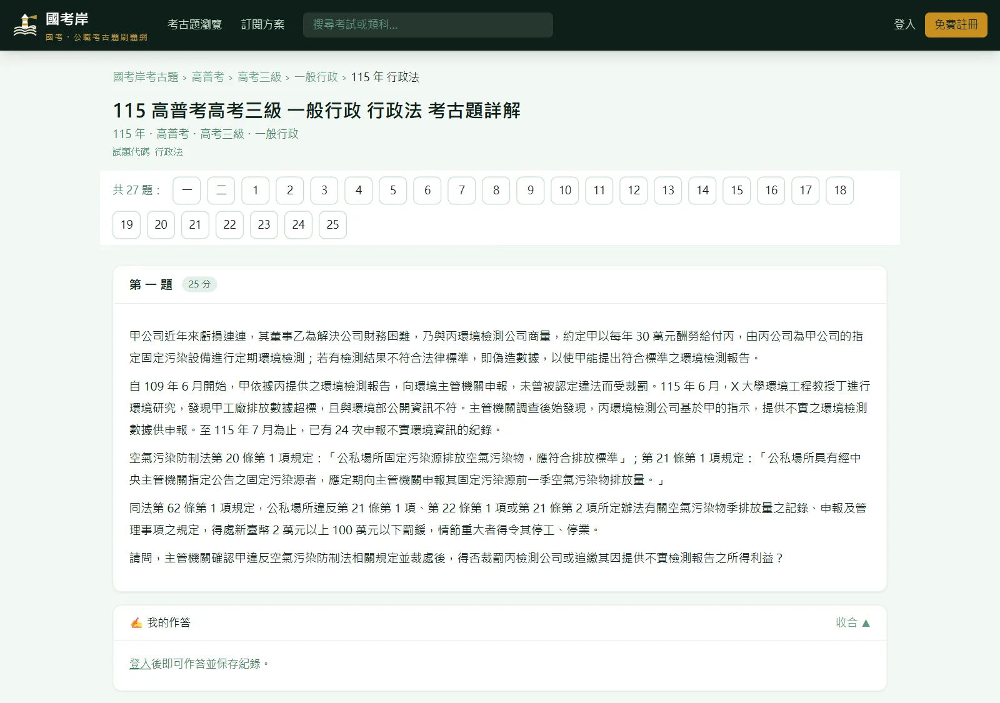
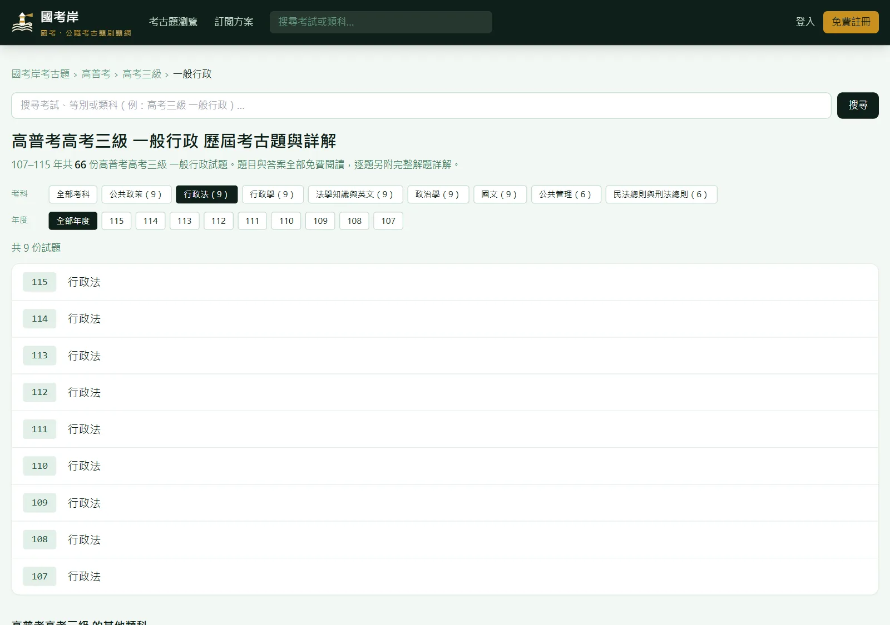
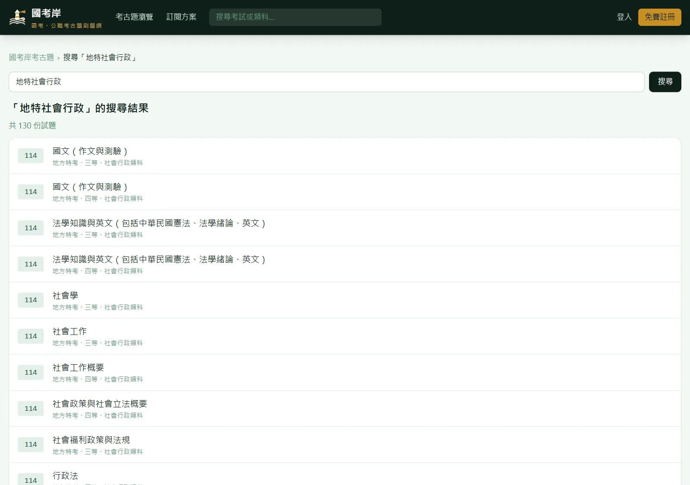
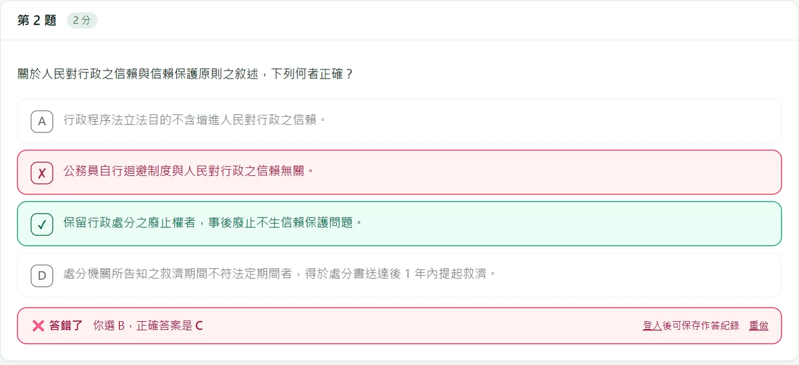
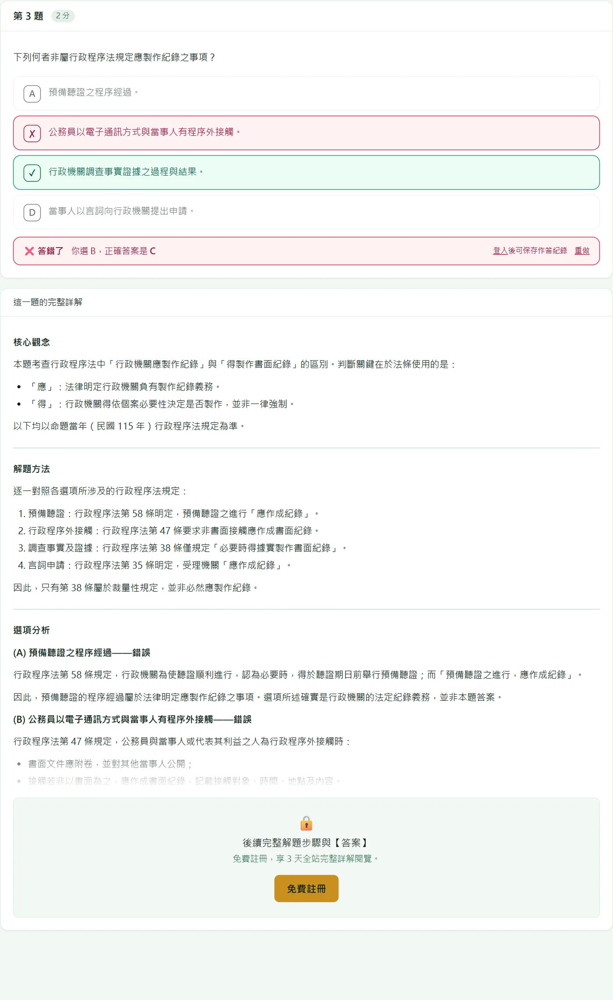
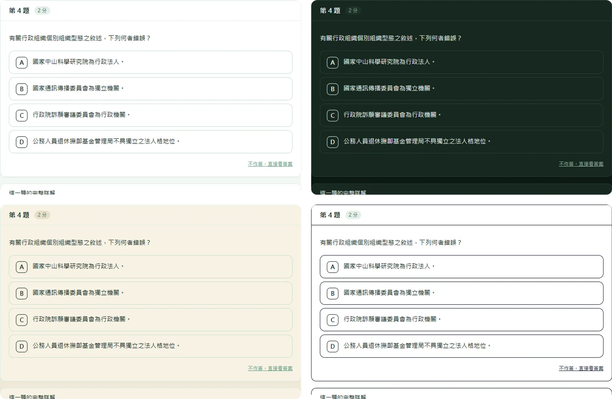
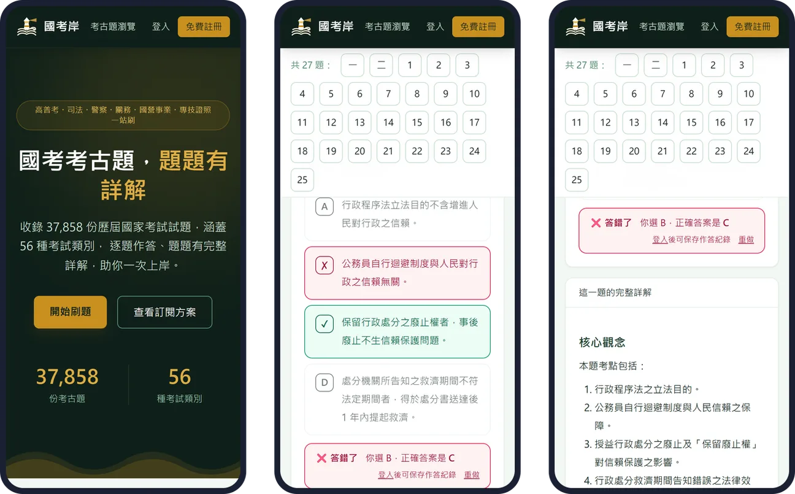

# 國考岸｜國考・公職考古題，逐題練習、逐題詳解

**網站：[gov.examshore.com](https://gov.examshore.com/)**
完整介紹頁：[b01b02014.github.io/gov-exam](https://b01b02014.github.io/gov-exam/)

國考岸是台灣國家考試與公職招考的考古題練習網站。收錄 107 到 115 年、56 種考試共 **37,858 份**考卷，
每份都拆成一題一題（超過 77 萬題）。選擇題直接點選作答、立刻對答案；申論題先寫下架構，再對照這一題的完整詳解。
高普考、地方特考、初等考試、司法、調查局、警察、關務、鐵路，到台電、經濟部聯招、中華郵政等國營事業招考，一個帳號全部通用。

## 網站特色

### 三下就找到你要考的那份卷

從考試名稱一路點到等別與類科，考科和年度一鍵篩選，同一類科歷年的考卷一次列出來。

搜尋框打簡稱也找得到：高考、普考、地特、司法特考、台電都認得，考試＋類科＋科目可以連著打、不用空格，
還能加上年度，例如「地特社會行政」「司法特考民法」「112 普考會計」。台、臺通用。

### 選擇題，點了就知道對錯

選項做成可以直接點的按鈕，點下去立刻標出對錯與正確答案（答案依考選部公告）。
也可以按「不作答，直接看答案」，或按「重做」再練一次。登入後作答紀錄會保存。

### 每一題都有完整詳解

詳解照「核心觀念、解題方法、選項分析、解題技巧、答案」的順序寫，選擇題會把每個選項為什麼對、為什麼錯都講清楚，並寫出依據的法條；
申論題附作答架構與示範作答。法律科目註明「以命題當年法規為準」。發現有誤可以在詳解下方回報，站方的回覆會出現在「我的帳戶」。

### 卡住的時候，不只是看答案

- **AI 盲點診斷**（訂閱）：把作答打字送出，或上傳手寫作答照片（最多 2 張），按「AI 找盲點」，系統對照標準解法指出漏掉的爭點與觀念。照片不會保存在伺服器。
- **本題相關概念總複習**（訂閱）：這題在考什麼、必懂的觀念、常考的變形、容易混淆的地方。
- **討論區與舉手發問**（會員）：每一題下方都能討論；想直接問站方就用「舉手發問」。

### 四種顯示模式

頁面最下方的「顯示模式」可以切換 **標準／深色／護眼／高對比**，不用登入，選一次就會記住。

### 手機、平板都順手

版面會跟著螢幕調整：題號列自動換行、選項按鈕夠大好點、上傳照片直接開相機。

**安裝到主畫面**：iPhone、iPad 用 Safari 點「分享」→「加入主畫面」；Android 或電腦在瀏覽器選單選「安裝應用程式」或「加到主畫面」，
登入後「我的帳戶」頁也有安裝按鈕。之後從主畫面點圖示，就像 App 一樣全螢幕開啟。

## 收錄範圍：56 種考試，107 到 115 年

| 類別 | 份數 | 包含 |
|---|---:|---|
| [綜合國家考試](https://gov.examshore.com/exams/senior-junior) | 19,799 | 高普考、地方特考、專技高考、初等考試 |
| [司法・調查・涉外](https://gov.examshore.com/exams/judicial) | 4,789 | 司法特考、調查局、外交、移民、國安局、律師 |
| [警察・消防・海巡](https://gov.examshore.com/exams/police) | 2,073 | 警察特考、一般警察、海巡、消防設備人員 |
| [關務・地政・不動產](https://gov.examshore.com/exams/customs) | 1,222 | 關務特考、地政士、不動產經紀人、報關人員 |
| [交通事業](https://gov.examshore.com/exams/railway) | 1,738 | 鐵路特考、民航特考、捷運招考、港務與公路升資 |
| [國營事業招考](https://gov.examshore.com/exams/state-owned-joint) | 346 | 經濟部聯招、台電、中華郵政、臺灣菸酒、台水 |
| [專技・證照](https://gov.examshore.com/exams/x-a373b2) | 1,609 | 專利師、導遊領隊、社工師、驗光、食品技師、記帳士 |
| [財稅・金融證照](https://gov.examshore.com/exams/x-b1f9c1) | 379 | 稅務特考、保險、證券、期貨、信託理財 |
| [升官等・轉任・其他](https://gov.examshore.com/exams/x-905734) | 5,903 | 公務人員升官等、原住民特考、身障特考、農漁會 |

## 註冊方式

登入只要 Google、Facebook 或 LINE 一鍵完成。全部考古題的題目與答案免費閱讀；新會員註冊後 3 天內可以看全站完整詳解，
每份考卷的第 1 題註冊會員隨時都能看完整詳解。之後想繼續使用完整詳解、盲點診斷與概念總複習，再到[方案頁](https://gov.examshore.com/pricing)挑選。

---

考題著作權屬考選部及各命題機關所有，國考岸僅供考生學習使用。聯絡：service@examshore.com
